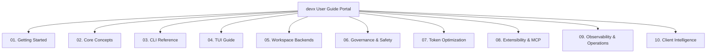

# `devx` User Guide

Welcome to **`devx`**, your local-first, approval-gated AI coding partner.

`devx` pairs you with an autonomous coding agent that respects your code and your authority. It delivers a fast, terminal-native "vibe coding" experience — expressing intent, reviewing implementation plans, inspecting unified diffs, and keeping 100% control over every change.

---

## Complete Multi-Page Guide Chapters

Explore the comprehensive topic guides in the [`docs/user-guide/`](user-guide/) suite:



| Chapter | Overview |
|---|---|
| [**1. Getting Started**](user-guide/01-getting-started.md) | Prerequisites, packaging extras, global PATH setup, interactive init wizard, diagnostics, and first task |
| [**2. Core Concepts**](user-guide/02-core-concepts.md) | Supervisor state machine (Planner, Coder, Parallel Coder, Tester, Repair Loop), approval gates, operational modes, session branching, and knowledge graph |
| [**3. CLI Reference**](user-guide/03-cli-reference.md) | Exhaustive documentation of all CLI commands, review, design, test intelligence, and session management |
| [**4. TUI Workflow Guide**](user-guide/04-tui-guide.md) | Full layout breakdown, modal dialogues, operational modes, session trees, slash commands, shortcuts, and clipboard |
| [**5. Workspace Backends**](user-guide/05-workspace-backends.md) | Governed execution across Local (with Bubblewrap sandbox), SSH (`--remote`), Containers (`--container`), and Lab (`devx lab`) |
| [**6. Governance, Safety & Secret Hygiene**](user-guide/06-governance-and-safety.md) | Automated secret scanning/redaction, policy presets, repository rules (`.devx/rules`), permissions, and rollbacks |
| [**7. Token Optimization & Caching**](user-guide/07-token-optimization.md) | Local ONNX INT8 embeddings, semantic caching, conversation compaction, decoupled context, and diagnostic distillation |
| [**8. Extensibility, Plugins & MCP**](user-guide/08-extensibility-and-mcp.md) | Writing Python workspace plugins, stdio MCP servers, custom skills (`.devx/skills`), and safety boundaries |
| [**9. Observability, Operations & Team**](user-guide/09-observability-and-ops.md) | Prometheus metrics exposition, LangSmith tracing, DLQ triage & replay, circuit breakers, fallback cascading, and team manifests |
| [**10. Client-Side Intelligence**](user-guide/10-client-intelligence.md) | Multi-perspective code review, codebase topology extraction, Mermaid diagram synthesis, ADR authoring, Test-Impact Analysis (TIA), and flakiness probing |

---

## 5-Minute Quickstart

### Step 1: Install `devx`

In your Python 3.11+ environment:

```bash
# Option A: Standalone global CLI install via pipx (recommended for users)
pipx install "devx-coding-agent[all]"

# Option B: Clone & editable development mode (for contributors)
git clone https://github.com/cosq-network/devx.git
cd devx
pip install -e ".[all]"
```

### Step 2: Initialize Your Workspace

Run the initialization wizard in your project root:

```bash
cd /path/to/your/project
devx init
```

The full-screen TUI wizard will guide you through picking your LLM provider (OpenRouter, OpenAI, Anthropic, Google, Azure, Ollama), selecting an agent-ready coding model, entering your API key, and toggling local embeddings.

*For automated CI / container setups, use non-interactive mode:*
```bash
devx init --provider openrouter --model openrouter/free --api-key "$API_KEY" -y
```

### Step 3: Verify Environment Health

```bash
devx doctor
devx health
```

Ensure configuration, session database, and extras are marked healthy (`[ok]`).

### Step 4: Run Your First Task

```bash
# In the CLI:
devx ask "explain how authentication works in @src/auth.py"

# Or launch the interactive terminal UI:
devx tui
```

---

## Quick Reference Cheat Sheet

### Common CLI Tasks

```bash
# Plan-only mode (preview plan without making any changes)
devx ask --plan-only "architect database migration to PostgreSQL"

# Skip the initial plan confirmation prompt
devx ask --no-plan-first "fix typo in @README.md"

# Auto-approve all edits (use only in isolated/trusted containers)
devx ask --approve-all "run pytest and format all files"

# Continue a named session
devx ask --session feature-auth "add rate limiting to the token endpoint"

# Remote server development over SSH
devx ask "fix healthcheck in @app.py" --remote dev-box:/srv/app

# Docker container development (zero bind mounts required)
devx ask "run pytest" --container container://devx-lab-8f12a3bc/config/repo

# Revert a file touched in the last run
devx changes reject src/auth.py

# Verify workspace drift against change journal
devx verify

# Pre-commit secret sweep
devx scan-secrets src/

# Automated multi-perspective code review
devx review --staged
devx review --branch main

# System design diagrams and Architectural Decision Records
devx design --diagram flowchart
devx design --adr "Adopt Event Bus"

# Intelligent testing: impact analysis and flakiness probing
devx test impact
devx test flaky tests/test_calc.py --runs 5

# Session tree branching and context compaction
devx session tree
devx session fork 4f2a1c --name new-feature
devx session compact 4f2a1c

# PR summary and token cost receipt
devx report my-session --out pr-body.md
devx usage --run 4f2a1c --markdown
```

### Common TUI Shortcuts & Commands

| Key / Command | Action |
|---|---|
| `/setup` | Configure provider, coding model, and API key |
| `/mode [name]` | Switch operational mode: `architect`, `code`, `review`, `ask` |
| `/diff` | Display the current bounded Git diff |
| `/undo` | Roll back all approved changes from the previous run |
| `/review` | Run automated multi-perspective review on current diff |
| `/design [kind]` | Synthesize Mermaid architecture diagram (`flowchart`, `class`, `seq`) |
| `/adr <title>` | Create and persist an Architectural Decision Record |
| `/test [impact\|flaky]` | Run selective impacted tests or probe test flakiness |
| `/plan <task>` | Create an implementation plan without modifying files |
| `/fork [name]` | Fork current conversation into a new branch |
| `/tree` | Visualize the session branch hierarchy |
| `/compact` | Compact session context to bound token usage |
| `/session` | List or switch active sessions |
| `/cancel` | Cancel an active agent run immediately |
| `/remote connect <uri>` | Switch to a remote SSH workspace |
| **Ctrl+C** *(single)* | Cancel active run / copy transcript when idle |
| **Ctrl+C** *(twice)* | Quit the TUI |
| **Ctrl+Q** | Quit the TUI with remote backend cleanup |
| **Ctrl+L** | Clear transcript view |
| **F1** | Open Help panel |
| **F2** / **Ctrl+Insert** | Copy transcript to system clipboard |

---

## Additional References

- [Architecture Guide](architecture.md) — Deep dive into state graphs, process groups, and serialization formats.
- [Threat Model](threat-model.md) — Attack surfaces, threat actors, and containment boundaries.
- [Governed Remote Execution](governed-remote.md) — Full security guarantees for SSH and container backends.
- [Extensibility Guide](extensibility.md) — In-depth guide to writing workspace plugins and MCP integrations.
