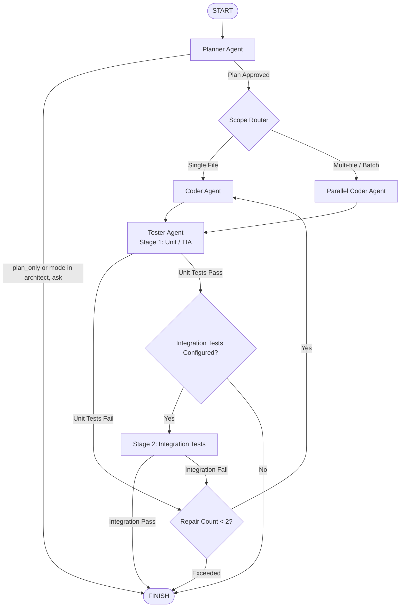
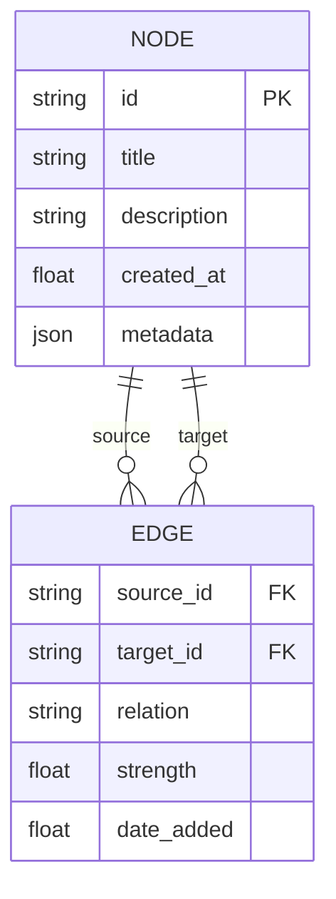

# Core Concepts of `devx`

Understanding `devx` comes down to five foundational architectural principles:
1. **The Supervisor State Machine**: Multi-agent coordination with specialized roles.
2. **The Approval Gate & Fail-Closed Safety**: You hold total authority over all disk mutations and commands.
3. **Session Persistence**: Complete, replayable event history backed by SQLite.
4. **Context Ingestion & File Mentions**: Deterministic `@path` token targeting.
5. **The Knowledge Graph**: Long-term memory and concept relationship tracking across sessions.

---

## 1. The Supervisor State Machine

At runtime, `devx` executes a graph-based state machine powered by LangGraph. Rather than relying on a single monolithic prompt, `devx` delegates work to specialized, bounded agent nodes:



### Specialized Agent Roles & Operational Modes

`devx` supports four operational personas configured via `/mode <name>` or `--mode <name>`:
- **`code` (Default)**: Full implementation mode with file mutation, command execution, and test verification.
- **`architect`**: System exploration, dependency topology scanning, and architectural planning without modifying any files.
- **`review`**: Code review mode allowed to inspect git diffs, examine test coverage, and execute verification commands without modifying source files.
- **`ask`**: Conversational technical Q&A without tool mutations.

### Specialized Agent Roles

- **Planner**:
  - Ingests task instructions, `@`-mentioned files, and workspace summaries.
  - Generates a concrete, numbered implementation plan.
  - In `--plan-only` mode (or via `/plan` in the TUI), execution halts after planning, allowing safe architectural review without touching any files.
- **Scope Router**:
  - Analyzes the plan to determine file touched count and keyword intent (e.g. "batch", "multiple files", "across the project").
  - Dynamically routes either to the standard Coder or the high-throughput **Parallel Coder**.
- **Coder & Parallel Coder**:
  - Implements the minimal necessary code diff.
  - Parallel Coder simultaneously reads target files and emits coordinated patches across multiple modules.
  - Triggers the **Approval Gate** before writing bytes or deleting lines.
- **Tester**:
  - Auto-detects the project's test framework (`pytest`, `npm test`, `cargo test`, `go test`, `mvn test`) or runs user-configured commands (`DEVX_TEST_COMMAND`).
  - Executes tests in parallel with lint checks (`DEVX_LINT_COMMAND`).
  - If a test fails, extracts and distills the error traceback and feeds it back into the Coder for a bounded repair loop (maximum 2 automated repair attempts).

---

## 2. The Approval Gate & Fail-Closed Safety

Traditional AI coding assistants either force you to manually copy-paste code snippets from a chat sidebar or aggressively edit your files without asking. `devx` adheres to an explicit **approval-first model**:

```
Describe Task ──► Agent Plans ──► You Review Plan ──► Agent Previews Diff ──► You Approve ──► Tests Run
```

### What Requires Approval?

By default (`DEVX_APPROVAL_REQUIRED=true`), every action that modifies system state requires explicit interactive consent:
1. **File Writes & Edits** (`write`, `replace`): Shows the relative target path and a unified diff preview.
2. **Shell Commands** (`shell`): Shows the exact bash / powershell command line.

In the interactive TUI, approvals appear in a centered modal dialog with action details, rationale, and diff preview:
- **Approve**: Executes the single action.
- **Deny**: Rejects the proposed action and instructs the agent to propose an alternative.
- **Cancel Run**: Immediately halts the active execution graph.

### Fail-Closed Security in Headless Environments

In automated pipelines, CI jobs, or background scripts where no interactive TTY is attached:
- If a write or command requires approval and no approval handler is supplied, `devx` **fails closed** (`WRITE DENIED`, `COMMAND DENIED`).
- To allow autonomous execution in sandboxed environments (such as ephemeral Docker containers), you must explicitly supply `--approve-all`:

```bash
# In an ephemeral Docker container or throwaway lab:
devx ask --approve-all "apply black formatting and run pytest"
```

---

## 3. Persistent SQLite Sessions

Every run in `devx` belongs to a session tracked inside `~/.devx/sessions.db`. Sessions record:
- Full conversation history and message compaction checkpoints.
- Step-by-step agent event timelines (`agent_started`, `plan_generated`, `tool_invoked`, `diff_previewed`, `test_finished`).
- Change journal records with pre/post SHA-256 hashes for every modified file.
- Exact token counts and cost estimates per model call.

### Resuming, Forking, and Tree Branching

`devx` treats sessions as a directed conversation tree rather than a flat linear list:

```bash
# In the CLI: Continue a named session
devx ask --session refactor-auth "now add rate limiting to the token endpoint"

# Fork the current session into a new experimental branch:
devx session fork refactor-auth --name auth-oauth-experiment

# Visualize the full session branch tree hierarchy:
devx session tree

# Compact historical messages into a milestone summary to bound context:
devx session compact refactor-auth
```

In the TUI:
```text
/fork oauth-flow
/tree
/compact
/session use refactor-auth
```

### Exporting and Sharing Sessions

Export a complete session as a portable JSON file to share a reproducible bug trace or architecture plan with a colleague:

```bash
devx session export refactor-auth session-backup.json
devx session import session-backup.json
```

---

## 4. Context Ingestion & `@` File Mentions

Language models cannot reliably guess which of your thousands of repository files are relevant. `devx` gives you deterministic control over context via `@` file mentions.

### Syntax and Resolution

Use `@path/to/file` anywhere in your prompt:

```bash
devx ask "add a retry decorator to @src/api/client.py using @src/utils/retry.py as reference"
```

How `devx` resolves `@` mentions:
1. **Exact Relative Path**: Matches files relative to the workspace root (`@src/api/client.py`).
2. **Directory Qualified Suffix**: Matches paths ending in the specified subpath (`@client.py` matches `src/api/client.py` if unique).
3. **Ambiguity Guard**: If multiple files share the same filename (e.g. `tests/test_api.py` vs `src/test_api.py`), `devx` prompts for clarification rather than guessing.

### In-TUI Autocomplete

In the TUI, typing `@` opens an inline fuzzy autocomplete popup listing files in your project. Press **Tab** or **Right Arrow** to complete the filename.

---

## 5. The Knowledge Graph

In addition to ephemeral session logs, `devx` maintains a structured SQLite Knowledge Graph (`~/.devx/knowledge_graph.db`).



### Purpose and Capabilities
- **Cross-Session Retrieval**: Frequently touched files, architectural concepts, and recurring bugs are tracked as nodes.
- **Relational Edges**: When two modules are frequently modified together during refactors, an edge (`relates_to`, `depends_on`, `tests`) is created or strengthened.
- **Lesson Learning**: Outcomes from task execution (e.g. "auth middleware requires JWT header normalization before decoding") are indexed to prevent repeating past mistakes in subsequent runs.
- **Thread-Safe Access**: Serialized via `threading.RLock()` to guarantee safe read/write access during parallel tool execution.

---

## Next Steps

- Consult the [CLI Reference](03-cli-reference.md) for full syntax of all command-line operations.
- Read the [TUI Guide](04-tui-guide.md) to learn how to operate `devx` interactively.
- Review [Governance and Safety](06-governance-and-safety.md) for details on policy presets, secret scanning, and change rollbacks.
