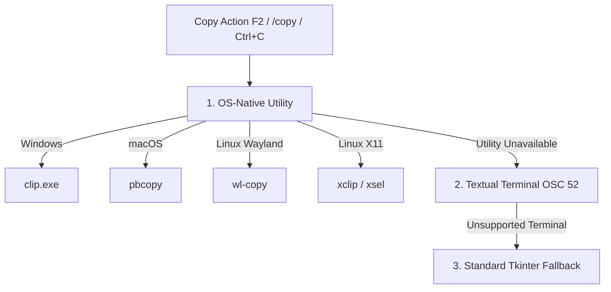

# TUI Workflow Guide for `devx`

The `devx` Terminal User Interface (TUI) is a full-screen, keyboard-driven environment built with [Textual](https://textual.textualize.io/). It combines the velocity of conversational AI with the safety of inline diff reviews and deterministic undo operations.

---

## 1. Launching the TUI

Start the TUI from any project root:

```bash
# Launch interactive TUI in the current workspace
devx tui

# Or simply:
devx

# Or resume a specific saved session:
devx tui --session feature-auth
```

---

## 2. Interface Layout

The TUI is organized into four primary functional zones:

```
┌────────────────────────────────────────────────────────────────────────┐
│ [devx]  Provider: openrouter | Model: openrouter/free | Workspace: .   │ Top Bar
├────────────────────────────────────────────────────────────────────────┤
│                                                                        │
│ > refactor the JWT validation middleware                               │
│                                                                        │
│ PLAN:                                                                  │
│ 1. Inspect @src/auth.py for header extraction logic.                  │ Main Transcript
│ 2. Add bearer token normalization and audience checks.                 │ (RichLog)
│ 3. Run pytest tests/test_auth.py to verify.                            │
│                                                                        │
│ [Approve Write: src/auth.py] (Modal Dialogue)                          │
│                                                                        │
├────────────────────────────────────────────────────────────────────────┤
│ Context: 12k / 200k tokens | ● copied transcript to clipboard (clip)   │ Status Bar
├────────────────────────────────────────────────────────────────────────┤
│ > @src/auth.py _                                                       │ Input Prompt
└────────────────────────────────────────────────────────────────────────┘
```

1. **Top Bar**:
   - Active LLM Provider (`openrouter`, `openai`, `anthropic`, `google`, `azure`, `ollama`).
   - Active Coding Model.
   - Workspace target (local directory or remote indicator `dev-box:/srv/app`).
   - Active Session ID.
2. **Main Transcript (`RichLog`)**:
   - Streaming markdown output and reasoning steps.
   - Syntax-highlighted code blocks.
   - Live test execution outputs and linter reports.
3. **Status Bar**:
   - Token consumption indicators.
   - Clipboard action notifications (e.g. `● copied transcript to clipboard (clip)`).
   - Execution state indicators (`Idle`, `Planning`, `Coding`, `Running Tests`).
4. **Input Prompt**:
   - Multi-line text input.
   - Intelligent popup autocomplete triggered by `@` (files) and `/` (slash commands).

---

## 3. Slash Commands Reference

Slash commands provide instant control over configuration, sessions, models, and system state.

### Configuration & Credentials

| Command | Description |
|---|---|
| `/setup` or `/configure` | Open the interactive provider, model, API key, and base URL setup modal |
| `/config show` | Print active configuration settings with the API key safely masked |
| `/config reset` | Reset provider, model, and credentials back to built-in defaults |
| `/api-key set` | Open a masked modal dialogue to update only the provider API key |

### Provider & Model Management

| Command | Description |
|---|---|
| `/provider` | List all supported providers (`openai`, `openrouter`, `anthropic`, `google`, `azure`, `ollama`) |
| `/provider <number>` | Select a provider by list index |
| `/provider use <name>` | Select a provider directly by name (e.g. `/provider use anthropic`) |
| `/model` | Show curated, agent-ready coding models for the active provider |
| `/model <number>` | Select a curated model by list index |
| `/model live` | Query the provider endpoint live to discover all available models |
| `/model live tools` | Filter live models to those that explicitly report tool-calling support |
| `/model use <id>` | Select any model by identifier (e.g. `/model use claude-3-7-sonnet`) |

### Workflows & Execution Control

| Command | Description |
|---|---|
| `/plan <task>` | Formulate a detailed plan for `<task>` without executing file writes or commands |
| `/diff` | Display the current bounded Git diff of all uncommitted workspace changes |
| `/undo` | Roll back all approved file modifications from the previous agent run |
| `/cancel` | Cancel an active agent run immediately |
| `/copy` | Copy the entire transcript to the operating system clipboard |
| `/clear` | Clear the transcript screen (equivalent to `Ctrl+L`) |
| `/exit` | Gracefully disconnect remote backends and close the TUI |

### Session Management

| Command | Description |
|---|---|
| `/session` | List all saved sessions with creation dates and message counts |
| `/session use <id>` | Switch to and restore an existing session |
| `/session rename <name>` | Assign a human-readable name to the current session |
| `/session export <path>` | Export current session data to a JSON file |
| `/session import <path>` | Import a session backup into the local session database |

### Remote Workspaces

| Command | Description |
|---|---|
| `/remote connect <uri>` | Connect to a remote SSH workspace (e.g. `dev-box:/srv/app`) |
| `/remote disconnect` | Disconnect remote SSH backend and return to the local workspace |
| `/remote status` | Display connection status, host key details, and remote working directory |

### Help

| Command | Description |
|---|---|
| `/help` | Show the Quick Start guide and command overview |
| `/help setup` | Display help for provider and configuration setup |
| `/help provider` | Display provider management help |
| `/help model` | Display model curation and discovery help |
| `/help session` | Display session management help |
| `/help shortcuts` | List all keyboard shortcuts and navigation bindings |

---

## 4. Keyboard Shortcuts & Bindings

| Shortcut | Action | Details |
|---|---|---|
| **F1** | Open Help | Opens the comprehensive in-TUI help documentation |
| **Ctrl+C** *(single)* | Cancel Run / Copy | Cancels active run if executing; copies transcript if idle |
| **Ctrl+C** *(twice)* | Safe Quit | Pressing `Ctrl+C` twice within 1.5 seconds quits the application |
| **Ctrl+Q** | Quit | Directly exits the TUI and executes remote connection cleanups |
| **Ctrl+L** | Clear Transcript | Clears all scrollback text from the active transcript view |
| **F2** / **Ctrl+Insert** | Copy Transcript | Copies transcript to the system clipboard |
| **Right Arrow** / **Tab** | Accept Completion | Completes the selected suggestion in `@` or `/` autocomplete popups |
| **Escape** | Dismiss Modal | Closes non-mandatory modal dialogs |

---

## 5. Modal Dialogs

`devx` uses modal dialogs to capture decisions and credentials without polluting the conversation transcript.

### 1. Provider Setup Modal (`/setup`)
- Select provider and model using clean dropdowns.
- Masked API key entry field.
- Custom base URL input (automatically cleared for providers without canonical endpoints like Google and Azure).
- Embeddings toggle switch.

### 2. Approval Modal
Whenever the agent proposes writing code or executing a command, execution pauses on the worker thread, and an approval modal is marshaled onto the Textual UI thread:
- **Header**: Action type (`write`, `replace`, `shell`) and target file/command.
- **Reason**: The agent's stated justification.
- **Diff Preview**: Bounded, syntax-highlighted unified diff showing exactly what lines will be added or removed.
- **Buttons**:
  - `Approve`: Applies the modification.
  - `Deny`: Refuses the action and returns a denial error to the agent to prompt an alternative strategy.
  - `Cancel Run`: Cancels the entire task execution.

### 3. Plan Preview Modal (`/plan`)
- Presents an implementation plan before any code is generated.
- Allows approving the plan to proceed with execution or rejecting it to re-prompt.

---

## 6. Clipboard Integration & Mechanisms

`devx` implements a multi-tiered clipboard architecture to ensure reliable copy operations across diverse environments:



1. **Native OS Utilities**:
   - Windows: `clip.exe`
   - macOS: `pbcopy`
   - Linux: `wl-copy` (Wayland), `xclip`, `xsel` (X11)
2. **Terminal OSC 52 Sequences**:
   - If no native CLI clipboard utility is installed (such as inside headless Docker containers or minimal SSH shells), `devx` emits standard ANSI OSC 52 escape sequences so your local terminal emulator captures the clipboard content.
3. **Tkinter Fallback**:
   - Standard library clipboard fallback if GUI bindings are available.

The status bar displays which mechanism succeeded:
`● copied transcript to clipboard (clip)` or `● copied transcript to clipboard (osc52)`.

---

## Next Steps

- Learn about remote servers and Docker containers in [Workspace Backends](05-workspace-backends.md).
- Understand how `devx` protects credentials and rollback history in [Governance and Safety](06-governance-and-safety.md).
- Explore local ONNX models and caching in [Token Optimization](07-token-optimization.md).
