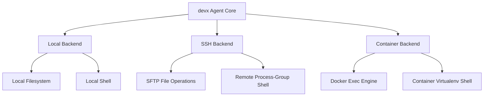

# Workspace Backends in `devx`

One of `devx`'s defining capabilities is **governed remote execution**. The same agent architecture, approval gates, secret masking, and hash-guarded change journals operate identically whether your project lives on your local workstation, a remote cloud server over SSH, or inside a running Docker container.



---

## 1. Local Backend

The **Local Backend** is the default workspace backend. It operates directly against files in the current working directory (or the path set by `DEVX_WORKSPACE`).

### Security & Traversal Guards
- Lexically prevents relative path escapes (`../..`).
- Symlinks pointing outside the workspace are rejected during file discovery and reads.
- Atomic writes: files are written to hidden temporary files first and then atomically swapped into place to avoid partial writes.

---

## 2. Governed SSH Workspace (`SshWorkspaceBackend`)

Work directly on cloud instances, remote Linux workstations, staging servers, or bare-metal machines without cloning repositories locally or exposing local files.

### Connection URI Formats

`devx` accepts two styles of SSH addresses:

1. **Direct URIs**:
   ```bash
   devx ask "profile slow queries in @app.py" --remote ssh://ubuntu@192.168.1.50:22/srv/my-service --ssh-key ~/.ssh/id_ed25519

# DEVX_SSH_KNOWN_HOSTS: Set this env var to your known_hosts file path
export DEVX_SSH_KNOWN_HOSTS=~/.ssh/known_hosts
   ```
2. **`~/.ssh/config` Host Aliases**:
   You can reference host aliases defined in your local `~/.ssh/config`:
   ```bash
   devx ask "run pytest" --remote dev-box:/srv/my-service
   ```
   *Benefit*: Host aliases automatically inherit all advanced SSH configurations, including:
   - `ProxyJump` and bastion jump-hosts.
   - Specific identity keys (`IdentityFile`).
   - Custom port configurations.
   - SSH agent forwarding.

### Remote Execution Features

- **Automatic Virtualenv Activation**:
  Commands executed on the remote server check for `.venv` in the workspace root and automatically source it (`. .venv/bin/activate`) before running project commands.
- **Process-Group Isolation & Safe Cancellation**:
  When a remote command starts, `devx` records its process group ID (`pgid`). If you cancel the run (`Ctrl+C` or `/cancel`), `devx` signals the entire remote process group (`kill -TERM -<pgid>`), ensuring that background sub-processes (e.g. background worker threads, test runners) do not become orphaned on the server.
- **Symlink Sandboxing**:
  Remote paths are canonicalized using SFTP `normalize()`. If a symlink inside the workspace resolves to a path outside the workspace (e.g. `/etc/passwd`), access is immediately denied with a `PermissionError`. When writing new files, ancestor directories are recursively validated.
- **Transparent Reconnection**:
  If the network connection drops intermittently, `devx` automatically attempts to re-establish the transport with exponential backoff (up to 3 attempts) before failing safely.

### Remote Preflight Diagnostics (`devx doctor --remote`)

Never run code against an unverified remote server. Run `devx doctor` with your remote URI to preflight the connection:

```bash
devx doctor --remote deploy@staging-server:/srv/api --ssh-key ~/.ssh/id_rsa
```

The preflight check verifies:
1. TCP connectivity and SSH authentication.
2. SFTP subsystem availability.
3. Workspace path existence and write permissions.
4. Remote Git presence.
5. Virtual environment status.

---

## 3. Governed Container Workspace (`ContainerWorkspaceBackend`)

Develop inside running Docker containers without needing bind mounts or local volume mirrors.

### Container URI Format

```bash
devx ask "patch bug in @app.py and run pytest" --container container://my-docker-container/app/repo
```

### Key Technical Guarantees

- **Zero Bind-Mounts**:
  File reads, writes, and shell executions are conducted entirely through `docker exec -i`, interacting directly with the container's internal filesystem.
- **Workdir Anchoring via `pwd`**:
  If you omit the remote path (e.g. `container://my-container`), `devx` queries `pwd` inside the container to establish a rock-solid root anchor. Absolute paths outside this anchor are forbidden.
- **Bounded Stream Capture**:
  Runaway commands printing megabytes of log output are capped using bounded chunk capture buffers, preventing out-of-memory failures on the host machine.
- **Symlink Containment**:
  Container paths are resolved using `realpath -m` (GNU coreutils) with a fallback to `readlink -f` (BusyBox) and ancestor traversal validation.

---

## 4. Disposable Container Lab (`devx lab`)

If you want to test remote execution or try `devx` in an isolated sandbox with zero setup, use the built-in **Lab**:

```bash
# Spin up an isolated disposable container
devx lab up
```

Example output:
```text
Started disposable remote workspace devx-lab-8f12a3bc
  remote:    devx ask --accept-new-keys --remote ssh://devx@127.0.0.1:49153/config/repo --approve-all 'your task'
  container: devx ask --container container://devx-lab-8f12a3bc/config/repo --approve-all 'your task'
  doctor:    devx doctor --accept-new-keys --remote ssh://devx@127.0.0.1:49153/config/repo
  stop:      devx lab down devx-lab-8f12a3bc
```

### Safety Features of `devx lab`:
- **Localhost Binding**: Binds strictly to `127.0.0.1` on a random ephemeral port — never exposed to external networks.
- **Ephemeral Keys**: Generates fresh host keys on boot (pass `--accept-new-keys` to trust).
- **Tear Down**:
  ```bash
  devx lab down devx-lab-8f12a3bc
  ```

### Declarative Docker Compose

You can also run the identical lab container declaratively using the repository's root [`docker-compose.yml`](../../docker-compose.yml):

```bash
docker compose up -d
```

---

## 5. Cross-Backend Verification & Drift Detection

The change journal records relative workspace paths. This allows audit and verification commands to inspect remote workspaces directly:

### Verifying Remote Workspaces for Drift
```bash
devx verify --remote dev-box:/srv/app
```
Compares hashes on the remote machine via SFTP. Exits `0` if all files match the journal, or `1` if unexpected drift occurred.

### Generating Remote PR Reports
```bash
devx report my-session --remote dev-box:/srv/app --out pr-summary.md
```
Threads the remote backend into the report generator, ensuring verified file diffs reflect the true state of the remote server.

---

## Next Steps

- Learn about policy presets and secret scanning in [Governance and Safety](06-governance-and-safety.md).
- Explore local ONNX embedding models in [Token Optimization](07-token-optimization.md).
- Learn how to extend `devx` with plugins and MCP in [Extensibility & MCP](08-extensibility-and-mcp.md).
