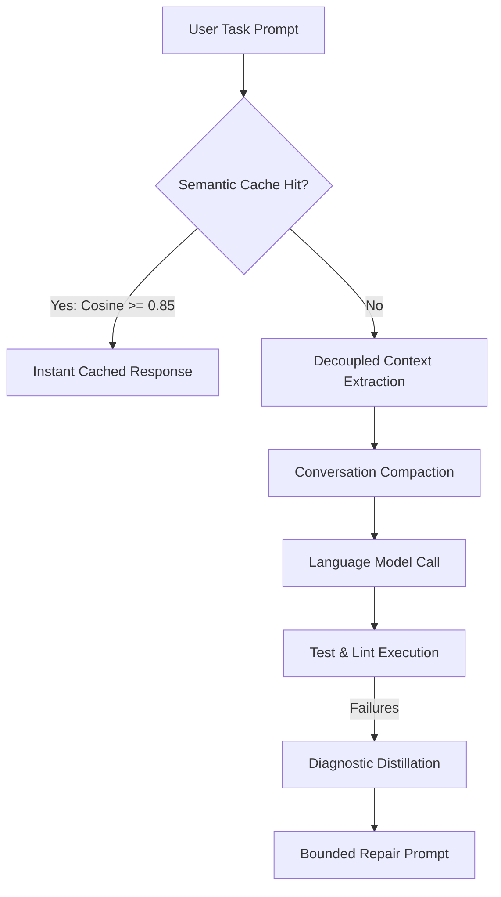

# Token Optimization & Caching in `devx`

LLM tokens represent both financial cost and latency. Large codebases can easily exhaust model context windows if raw files and verbose stack traces are sent indiscriminately.

`devx` incorporates a client-side **Token Optimization Suite** that runs locally on your machine to shrink prompt payloads, cache repeated semantic queries, and compress long conversations.



---

## 1. Local ONNX Embeddings

`devx` uses local, client-side embeddings for semantic codebase search and cache retrieval. No code or query embeddings are ever sent to third-party embedding APIs.

### Key Specifications
- **Model Architecture**: `sentence-transformers/all-MiniLM-L6-v2`
- **Quantization**: INT8 ONNX runtime (executes in milliseconds on standard CPUs with minimal memory overhead).
- **Offline By Default**: `DEVX_EMBEDDINGS_OFFLINE=true` prevents unexpected model downloads in air-gapped or CI environments.
- **Cache Location**: `~/.cache/devx/embeddings` (configurable via `DEVX_EMBEDDING_CACHE_DIR`).

### Enabling Embeddings
Enable embeddings during project initialization:
```bash
devx init --embeddings -y
```
Or set in your `.env`:
```env
DEVX_EMBEDDINGS_ENABLED=true
DEVX_EMBEDDINGS_OFFLINE=true
```

---

## 2. Semantic Caching (`SemanticCache`)

When querying codebase explanations, architecture questions, or repeated code patterns, `devx` consults an embedded SQLite semantic cache (`~/.devx/cache.db`).

### Cache Lookup Mechanics
1. **Query & Workspace Fingerprinting**: Combines the provider, model, query string, and file modification timestamps into a SHA-256 key.
2. **Exact Hash Match**: If an identical query against the same file state exists, the cached result is returned instantly with zero LLM latency and zero token cost.
3. **Cosine Similarity Match**: When embeddings are enabled, `devx` computes vector similarity. If cosine similarity exceeds the threshold (default: `0.85`), the cached answer is served.

### Re-Indexing & Cache Invalidation

If your repository undergoes major changes or you want to rebuild the semantic index from scratch:

```bash
# Rebuild index and clear stale cache entries
devx index --force

# Continuous background indexing mode (watches for file saves)
devx index --watch
```

---

## 3. Context Compaction

Long-running agent conversations can easily bloat token counts as messages accumulate. `devx` automatically compacts conversation history according to rules defined in `.devx/config.json`:

```json
{
  "context_compaction": {
    "enabled": true,
    "max_messages": 24,
    "max_chars": 24000,
    "summary_chars": 4000
  }
}
```

### Compaction Flow:
- **Message Windowing**: Keeps the most recent messages (default: 24) in full detail.
- **Automated Summarization**: Older turns beyond the window are distilled into an authoritative context summary block (`summary_chars: 4000`).
- **Preserved System Directives**: Core system prompts, tools, and active plan objectives are never discarded during compaction.

---

## 4. Decoupled Coder Context

Sending full file contents for dozens of files to both the Planner and Coder agents wastes thousands of tokens. `devx` uses **Decoupled Coder Context**:

1. **Planner Context**: Receives a lightweight **File Manifest** (`generate_file_manifest`) containing file paths, line counts, and top-level symbol signatures (`class`, `def`, `async def`, `function`).
2. **Coder Context**: Only when the Coder is actively editing a specific module are the full file bytes ingested.
3. **Savings**: Reduces initial planning token consumption by 60% to 80% on multi-module tasks.

---

## 5. Diagnostic Distillation

During the automated testing and repair loop, test frameworks often emit massive terminal outputs containing environmental diagnostics, thousands of passing tests, and verbose stack traces.

When `DEVX_DIAGNOSTIC_DISTILLATION_ENABLED=true`:
- `devx` isolates only the failing test assertions and the immediate call-site frames.
- Passing test logs, warnings, and system diagnostics are distilled away.
- The Coder receives a concise, distilled error payload, allowing the repair loop to converge quickly without exceeding token context limits.

Enable in `.env`:
```env
DEVX_DIAGNOSTIC_DISTILLATION_ENABLED=true
```

---

## Next Steps

- Learn how to connect custom tools and MCP servers in [Extensibility & MCP](08-extensibility-and-mcp.md).
- Monitor token spend and operational health in [Observability & Operations](09-observability-and-ops.md).
- Return to the [User Guide Index](../user-guide.md).
