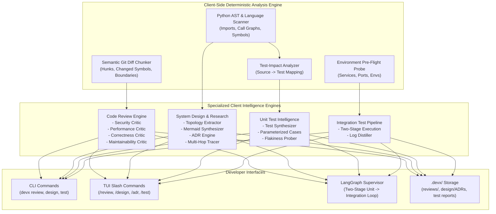

# Chapter 10: Client-Side Agent Intelligence

`devx` incorporates local-first **Client-Side Agent Intelligence** running directly within the developer's client environment. Rather than relying solely on raw LLM prompts, `devx` combines fast, deterministic standard-library static analysis (AST parsing, call graph tracing, git diff parsing, Test-Impact Analysis) with multi-agent reasoning.



---

## 1. Automated & Multi-Perspective Code Review

### Overview
Code review in `devx` is an automated, structured multi-agent inspection rather than an unstructured chat prompt. It operates on your local Git working tree, staged changes, target branches, or specific commits.

### Key Capabilities
- **Deterministic Diff Analysis**: Unified git diffs are parsed into structured file and hunk objects. Risk factors are immediately flagged:
  - Deletion of test suites or test files.
  - Modifications to security-sensitive files (`auth`, `secret`, `permissions`).
  - Detection of suspected hardcoded credentials or API tokens in added lines.
- **Local Static Analysis Pre-Checks**: Before dispatching to the LLM, `devx` invokes installed local project linters (e.g. `ruff check`, `mypy`) on modified files and injects confirmed diagnostic findings into the review context.
- **4-Critic Review Perspective**:
  1. **Security Critic**: Authentication, authorization bypass, SQL/command injection, secrets, path traversal.
  2. **Performance Critic**: Algorithmic complexity, resource leaks, N+1 queries, unclosed file or database handles.
  3. **Correctness Critic**: Boundary conditions, null/None handling, off-by-one errors, exception paths, race conditions.
  4. **Maintainability Critic**: Clean code, readability, adhering to `.devx/rules/*.md`.
- **Structured Reports & Verdicts**: Every review yields a verdict (`APPROVED`, `CHANGES_REQUESTED`, `COMMENTED`), risk factors, and actionable review comments with line numbers and suggested diff patches.
- **Persistent Reports**: Reports are automatically saved to `.devx/reviews/review_<timestamp>_<name>.md`.

### Usage

```bash
# Review current working tree changes
devx review

# Review staged changes only
devx review --staged

# Review changes against main or a feature branch
devx review --branch origin/main

# Review a specific commit
devx review --commit a1b2c3d

# Emit machine-readable JSON (ideal for CI pipelines)
devx review --json --no-save
```

In the interactive TUI:
```text
/review
/review security
```

---

## 2. System Design, Architecture & Deep Research

### Overview
The `devx.design` engine gives your agent architectural perception. It analyzes module dependencies, class hierarchies, and call graphs directly from source code using Python `ast` reflection without running external language servers.

### Key Capabilities
- **Codebase Topology Scanner**:
  - Scans workspace files and extracts imports, exports, functions, classes, type hints, exceptions raised, and call sites.
  - Constructs a directed graph of internal cross-module dependencies.
  - Automatically identifies circular import cycles.
- **Mermaid Diagram Synthesizer**:
  - **Component Flowchart (`flowchart TD`)**: Visualizes module coupling and data flow.
  - **Class Hierarchy (`classDiagram`)**: Maps discovered classes, inheritance relationships, and methods.
  - **Call Sequence (`sequenceDiagram`)**: Traces cross-module function call chains.
- **Architectural Decision Record (ADR) Engine**:
  - Synthesizes standardized ADRs (Context, Decision, Consequences, Alternatives Considered).
  - Automatically indexes and saves records to `.devx/design/ADR-XXXX-<title>.md`.
- **Deep Research Multi-Hop Symbol Tracer**:
  - Given a symbol name or query, traces its definition, parameters, exception contracts, and all cross-file caller references.

### Usage

```bash
# Generate architecture flowchart in Mermaid format
devx design --diagram flowchart

# Generate class hierarchy diagram for models
devx design --diagram class --focus models

# Create a new Architectural Decision Record
devx design --adr "Adopt Event Driven Message Bus"

# Perform deep symbol research across the repository
devx design --explore "verify_token"
```

In the interactive TUI:
```text
/design
/design class
/design sequence
/adr Migrate Cache to Redis
```

---

## 3. Intelligent Unit Testing

### Overview
Running an entire test suite on every code edit wastes tokens and time. The `devx.test_engine` introduces **Test-Impact Analysis (TIA)**, automated test synthesis, and flakiness verification.

### Key Capabilities
- **Test-Impact Analysis (TIA)**:
  - Determines which test files are affected by modified source files by analyzing naming conventions (`src/calc.py` $\rightarrow$ `tests/test_calc.py`) and AST dependency graphs.
  - Executes only the relevant subset of tests during coding repair loops.
- **Automated Unit Test Synthesis**:
  - Analyzes a target function or class using AST reflection.
  - Synthesizes idiomatic, parameterized pytest suites covering happy paths, edge cases (None/null, empty collections, boundary extremes), negative paths (`pytest.raises`), and mocks (`unittest.mock`).
- **Flakiness & Determinism Prober**:
  - Runs target tests $N$ times in isolated processes with randomized hash seeds (`PYTHONHASHSEED`).
  - Detects race conditions, timing leaks, and order dependencies before code is committed.

### Usage

```bash
# Run tests impacted by recent git changes
devx test impact

# Run tests impacted by a specific file
devx test impact src/devx/rules.py

# Probe a test suite for flakiness (default: 3 runs)
devx test flaky tests/test_calc.py --runs 5

# Run standard unit tests
devx test unit
```

In the interactive TUI:
```text
/test impact
/test flaky tests/test_rules_discovery.py
```

---

## 4. Integration Testing & Supervisor Orchestration

### Overview
Integration testing requires careful orchestration: verifying environment prerequisites, executing fast unit tests first, and isolating long server traces.

### Key Capabilities
- **Pre-Flight Environment Health Diagnostics**:
  - Checks required socket ports, environment variables, and Docker daemon connectivity before firing integration tests.
  - Emits clear remediation steps if services are down, avoiding misleading test crashes.
- **Two-Stage Testing Pipeline in LangGraph Supervisor**:
  - **Stage 1 (Fast Unit / TIA)**: The agent runs unit tests or selective impacted tests first. If Stage 1 fails, the supervisor immediately routes back to the coder for repair, skipping slow integration tests.
  - **Stage 2 (Integration)**: Only after Stage 1 passes does the agent run integration suites.
- **Diagnostic Distillation for Integration Traces**:
  - Multi-service logs, stack traces, and HTTP payloads are distilled to extract exact failure points and error codes, feeding high-signal context into the repair prompt.

### Configuration

In `.devx/config.json` or environment variables:

```json
{
  "unit_test_command": "pytest tests/unit/ -q",
  "integration_test_command": "pytest tests/integration/ -q",
  "test_impact_enabled": true,
  "review_linter_enabled": true
}
```

Environment variable equivalents:
- `DEVX_UNIT_TEST_COMMAND`
- `DEVX_INTEGRATION_TEST_COMMAND`
- `DEVX_TEST_IMPACT=true`
- `DEVX_REVIEW_LINTER=true`
